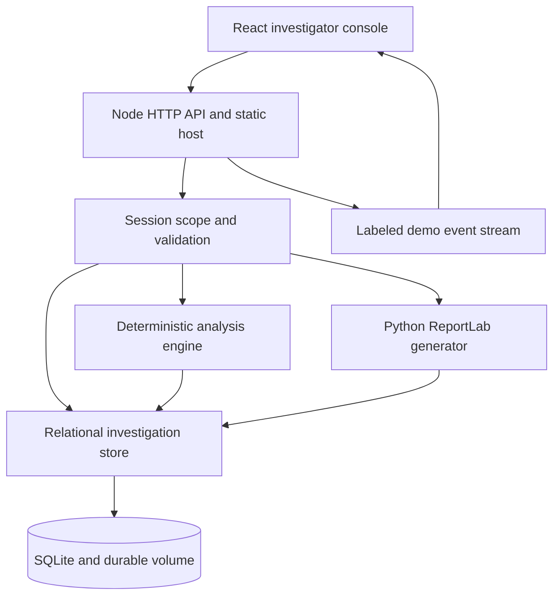
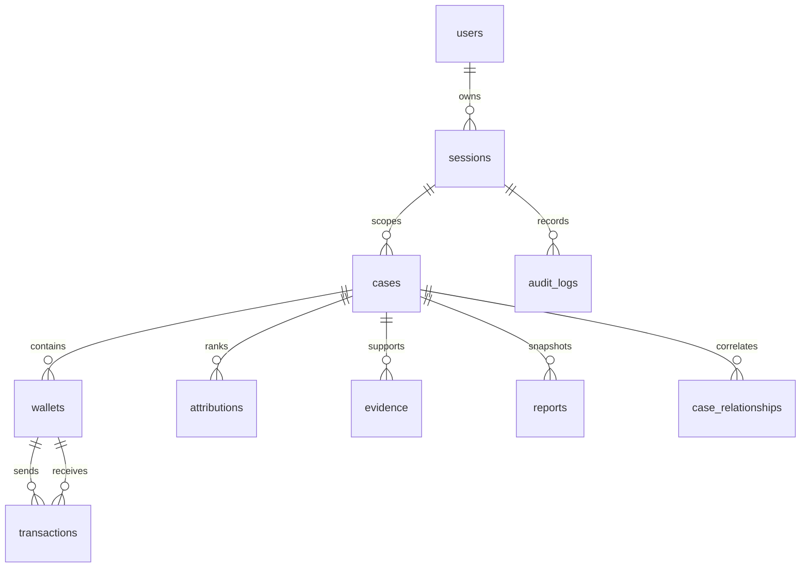

# Architecture

CRYPTO-TRACE INDIA is a complaint-centered investigation prototype. Its four product stages are **TRACE → ATTRIBUTE → CORRELATE → ACT**. Its current executable data plane is deterministic simulation, with no calls to public blockchains, VASPs, NCRP, or SAHYOG.

## Running components

The frontend and API share one origin. React, TypeScript, Vite, Recharts, and a custom interactive SVG graph provide the console. Node 24 exposes REST routes, validates inputs, issues anonymous demo sessions, performs analysis, persists records, and serves the compiled frontend. Python is used for PDF generation. A SQLite relational graph is the operational graph store in this build.

## Application boundaries

| Boundary | Responsibility | Current implementation |
| --- | --- | --- |
| UI | Cases, graph interaction, evidence inspection, correlation, alerts, reports, search | React components calling `/api` |
| API | Validation, session authorization, request limits, response headers, errors | Node HTTP service |
| Persistence | Session-scoped cases and reports; transactions and graph nodes; audit records | Prepared SQLite statements and a versioned migration |
| Blockchain adapter | Normalize a supported address and obtain a trace dataset | Deterministic synthetic data adapter |
| Analytics | Risk indicators, fingerprint features, weighted attribution, exit ranking, related cases | Explainable rules over the synthetic dataset |
| Assistant | Explain supported case questions with internal references | Deterministic case-grounded answer service |
| Report generation | Create versioned, timestamped PDF evidence summaries | Python/ReportLab subprocess; PDF bytes and hash stored in the database |
| Event stream | Provide an activity replay for the demo | Server-sent events labeled DEMO STREAM |
| External requests | Prepare a structured information-request package | Downloadable JSON; no external submission |

## Investigation lifecycle

1. An anonymous demo session receives its own six seeded cases. The opaque cookie token is stored as a SHA-256 hash in the database.
2. Case creation validates the complaint fields, amount, chain, and address format before inserting a case in the session scope.
3. Starting a trace generates a deterministic synthetic transfer graph for the case, then computes its analysis from that graph.
4. One transactional persistence operation stores wallets, transfers, clusters, attributions, evidence, features, cross-chain records, and the analysis snapshot.
5. Correlation compares the case with the other cases visible to the same session, using shared network relationships.
6. The workspace renders the graph and exposes linked evidence, candidate endpoints, risk explanations, patterns, and recommendations.
7. Evidence review, case changes, alert review, analysis, and report generation write audit events. Reports are immutable generated snapshots; a later retrace does not rewrite an earlier PDF.

The seeded graph is a scenario, not a reconstruction of real transactions. Entering a syntactically valid real-world address does not enable chain ingestion; use fictional values in this sandbox.

## Explainable scoring

The default attribution weights are configurable per demo session:

| Evidence class | Weight |
| --- | ---: |
| Address cluster | 25% |
| Transaction pattern | 20% |
| Deposit behavior | 15% |
| Temporal correlation | 15% |
| Cross-chain evidence | 10% |
| Historical interaction | 10% |
| External attribution | 5% |

For each candidate, confidence is the weighted sum of the evidence-class scores, with weights totaling 100. The UI exposes each weight, score, contribution, and associated transfer/wallet references. Applying changed weights requires retracing the case. The default fixture produces a 91% VASP-X score; this is a synthetic example, not a calibrated likelihood or externally verified attribution.

Risk and fraud-pattern outputs use behavioral rules. A pattern is described as “consistent with” a scenario. No trained classifier, XGBoost model, external AI model, or validation against real criminal cases is included. The code and reports must not turn a score into a claim of identity or guilt.

## Two graph views

The **transaction graph** represents synthetic transfer direction between wallets/services, with amounts, timestamps, hashes, chain metadata, wallet type, and risk.

The **attribution knowledge graph** represents semantic relationships among the case, wallets, clusters, candidate VASPs, transfers, bridge/privacy/DEX exposure, patterns, and evidence. It is an application graph generated from the relational records. It does not require or claim a running Neo4j server.

The graph representation can support a future storage adapter. A Neo4j implementation would need stable identifier mapping, tenant boundaries, synchronized writes, query limits, and dedicated tests; those changes have not been implemented.

## Database schema

The executable schema is [`migrations/001_initial.sql`](../migrations/001_initial.sql). SQLite foreign keys, WAL mode, a busy timeout, prepared statements, and explicit analysis transactions are enabled by `server/db.mjs`. The startup migration records its application in `schema_migrations`.

| Table | Principal fields / relationship | Purpose |
| --- | --- | --- |
| `users` | `id`, display name, demo role | Anonymous investigator identity |
| `sessions` | Token hash, `user_id`, expiry, weights | Session scope and attribution settings |
| `cases` | Session + case ID, complaint, chain, status, risk, loss, wallet | Complaint and investigation summary |
| `wallets` | `case_key`, address, chain, type, risk, cluster | Graph nodes and wallet intelligence |
| `transactions` | `case_key`, source/target wallet foreign keys, hash, amount, timestamp | Directed graph edges |
| `wallet_clusters` | `case_key`, cluster ID, entity | Grouped network components |
| `vasps` | ID, name, fictional marker, metadata | Fictional VASP-X/Y/Z catalog |
| `attributions` | `case_key`, candidate, confidence, traced amount | Candidate endpoint scores |
| `evidence` | `case_key`, evidence ID, kind, title | Supporting attribution and risk references |
| `fraud_patterns` | `case_key`, name, score | Behavioral pattern outputs |
| `cross_chain_transfers` | `case_key`, source/destination chain, amount, timestamp | Bridge linkage records |
| `alerts` | Session, case, severity, type, status, time | Reviewable investigator alerts |
| `reports` | Session, case, version, timestamp, SHA-256, PDF BLOB | Persisted report snapshots |
| `case_relationships` | Source/related case foreign keys, confidence | Cross-complaint correlation |
| `investigation_events` | Case, action, timestamp | Case-specific history |
| `audit_logs` | Session, user, action, object, metadata, timestamp | Application activity audit |
| `analyses` | Case, JSON analysis snapshot, update time | Cached fingerprint and knowledge graph |
| `schema_migrations` | Version, application timestamp | Migration history |

Complex node/edge/evidence fields are stored in JSON text payloads alongside indexed relational keys. This preserves a typed API shape while using real relational constraints for ownership and graph endpoints. Indexes cover case status, fraud/chain, wallet address, cluster, transaction hash/time/source/target, attribution confidence, evidence IDs, alerts, reports, timeline, and audit access.

**PostgreSQL is not used by the running application.** A migration would require a PostgreSQL driver/repository implementation, connection pooling, SQL and JSON/BLOB type changes, concurrency testing, data import, and deployment configuration. `DATABASE_URL` alone does not change storage. The existing repository boundary and graph objects identify the migration seam; they are not a completed PostgreSQL adapter.

## Security and evidence boundary

The API uses random opaque session tokens, HttpOnly cookies, server-side session scoping, validation, prepared SQL statements, same-origin checks, request limits, secure response headers, and safe client rendering. Audit events and report hashes help demonstrate traceability within the prototype.

The demo does not provide verified law-enforcement identity, organization membership, multi-role authorization, immutable external audit storage, cryptographic report signing, operational evidence custody, production KYC access, or a complete compliance regime. A report SHA-256 identifies the generated bytes; it is not proof that the synthetic underlying data is authentic.

Anonymous sessions are suitable for judges exploring fictional data. They are not authorization to handle actual complaints. Keep the synthetic-data banner and prohibit real victim details in publicly accessible deployments.

## Planned integration boundaries

`NCRPAdapter`, `SAHYOGAdapter`, and `VASPRequestAdapter` describe request preparation and integration boundaries. Without official credentials, documented protocols, and a reviewed authorization process, they remain disconnected. The prototype never contacts a VASP, freezes assets, accesses private KYC, or makes legal decisions.

Live chain support would additionally require provider credentials where applicable, actual transaction ingestion, finality/reorganization handling, token-decimal and price normalization, bridge-specific proofs, deduplication, provenance, monitoring, and regression tests. Existing chain labels are synthetic dataset coverage, not proof of a functioning live integration.
