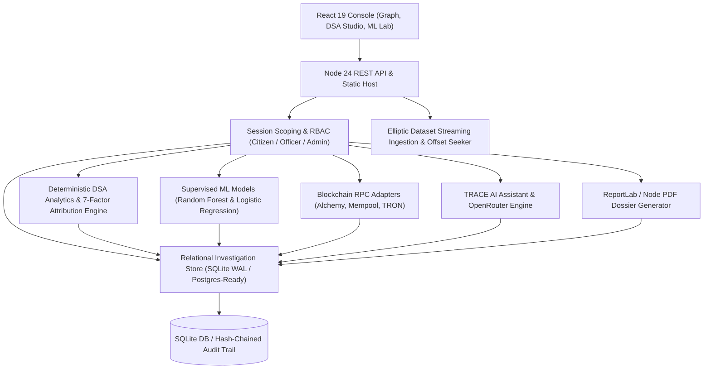
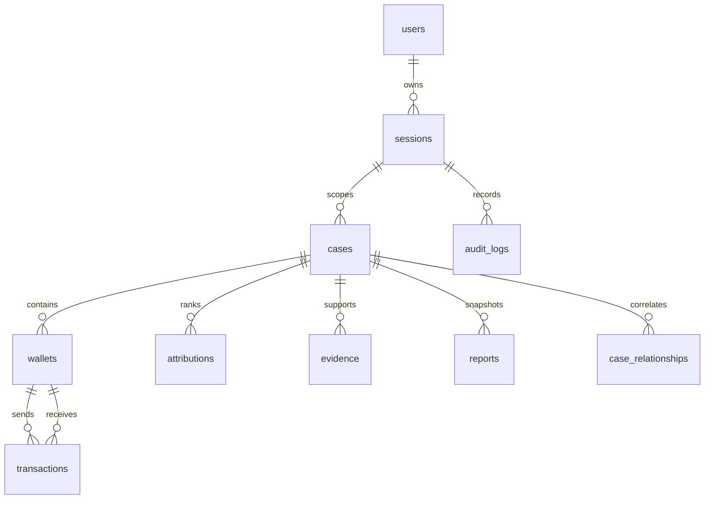

# Architecture

CYBER-TRACE is a full-stack cybercrime forensics and financial intelligence platform designed around the investigative lifecycle **TRACE → ATTRIBUTE → CORRELATE → ACT**. 

Its data plane operates on a dual architecture:
1. **Deterministic Benchmark & Mathematical Ground Truth Plane:** An offline-capable, reproducible analytical core powered by the Elliptic Bitcoin Transaction Dataset (203,769 nodes, 234,355 edges), trained Random Forest classifier (PR-AUC 0.7805 on holdout timesteps), graph algorithms (BFS, DFS, Dijkstra, Union-Find, Top-K Heap, Sliding Window), and a 7-factor weighted attribution engine.
2. **Credential-Gated Public Blockchain & Frontier AI Plane:** Modular adapters that connect to real public blockchains (Ethereum via Alchemy/RPC, Bitcoin via mempool.space, TRON via TronGrid) and frontier LLM reasoning (OpenRouter LLaMA-3.3-70B) when credentials are provided in `.env`, degrading gracefully to deterministic mathematical evaluation when unconfigured.

## Running components

The frontend and API share a single origin for production deployments. React 19, TypeScript 5.9, Vite 8, Lucide Icons, and custom interactive SVG graph canvases provide the user workspace. Node 24 serves REST endpoints, validates inputs, manages session scoping, executes DSA graph traversals, and interfaces with the dataset. Python ReportLab generates formal SHA-256 sealed PDF dossiers.

## Application boundaries

| Boundary | Responsibility | Current implementation |
| --- | --- | --- |
| UI | Cases, multi-hop graph interaction, evidence inspection, correlation, alerts, DSA Studio, ML Lab | React 19 components calling `/api` |
| API | Validation, RBAC session authorization, request limits, security headers, errors | Node 24 HTTP service |
| Persistence | Session-scoped cases and reports; transactions and graph nodes; audit records | Prepared SQLite statements and migration `001_initial.sql` (Postgres repository ready) |
| Blockchain adapters | Multi-hop on-chain tracing across Ethereum, Bitcoin, TRON, Polygon | Credential-gated live RPC adapters (Alchemy, Mempool.space, TronGrid) with deterministic fallback |
| Analytics & DSA | Graph traversal, connected components, shortest path, burst detection | In-memory graph algorithms in `server/graph/algorithms.mjs` |
| Machine Learning | Supervised illicit transaction classification and feature importance | Calibrated Random Forest & Logistic Regression in `server/ml/riskEngine.mjs` (PR-AUC 0.7805) |
| Assistant | Case-grounded evidence explanation with verifiable citations | Deterministic case-grounded assistant with optional OpenRouter LLaMA-3.3-70B engine |
| Report generation | Court-ready SHA-256 hashed PDF dossiers | Node.js / ReportLab Python subprocess; PDF hash and BLOB stored in database |
| External requests | Structured Section 91 / Section 94 BNSS Information Requests | Signed, structured JSON & PDF export packages; no external auto-dispatch |

## Investigation lifecycle

1. A citizen files a complaint with payment details, suspect identifiers, and proof uploads.
2. An investigating officer claims the case; the platform normalizes the reported wallet and initial hops.
3. Starting a trace triggers multi-hop forward traversal across public chains and banking hops.
4. Transactional persistence stores wallets, transfers, clusters, attributions, evidence, and features.
5. Cross-complaint correlation identifies shared intermediary mule accounts across independent cases.
6. The workspace renders the multi-hop chain with explicit provenance badges (`REAL_PUBLIC_ONCHAIN`, `USER_UPLOADED`, `INSTITUTION_RESPONSE`, `SYNTHETIC_ILLUSTRATIVE`, `ML_INFERRED`). Where records are missing, visible GAP nodes indicate required bank/VASP responses.
7. The officer generates a formal Section 91 Cr.P.C. / Section 94 BNSS information request and freeze requisition package.
8. Every state transition and evidence access is recorded in an immutable, append-only audit trail.

## Explainable scoring

The default attribution weights are configurable per session:

| Evidence class | Weight |
| --- | ---: |
| Address cluster | 25% |
| Transaction pattern | 20% |
| Deposit behavior | 15% |
| Temporal correlation | 15% |
| Cross-chain evidence | 10% |
| Historical interaction | 10% |
| External attribution | 5% |

For each candidate endpoint, confidence is the weighted sum of evidence-class scores totaling 100%. The UI exposes each weight, individual signal score, contribution, and supporting transaction/wallet citations.

### Probabilistic Leads vs Proof of Guilt
Risk scores and machine learning predictions are probabilistic investigative leads to assist law enforcement in prioritization. They do not constitute judicial proof of guilt. Unlabeled transactions (`unknown`) in the benchmark dataset are strictly treated as unverified entities and never treated as licit by default.

## Two graph views

The **transaction graph** represents synthetic transfer direction between wallets/services, with amounts, timestamps, hashes, chain metadata, wallet type, and risk.

The **attribution knowledge graph** represents semantic relationships among the case, wallets, clusters, candidate VASPs, transfers, bridge/privacy/DEX exposure, patterns, and evidence. It is an application graph generated from the relational records. It does not require or claim a running Neo4j server.

The graph representation can support a future storage adapter. A Neo4j implementation would need stable identifier mapping, tenant boundaries, synchronized writes, query limits, and dedicated tests; those changes have not been implemented.

## Database schema

The executable schema is [`migrations/001_initial.sql`](../migrations/001_initial.sql). SQLite foreign keys, WAL mode, a busy timeout, prepared statements, and explicit analysis transactions are enabled by `server/db.mjs`. The startup migration records its application in `schema_migrations`.

| Table | Principal fields / relationship | Purpose |
| --- | --- | --- |
| `users` | `id`, display name, demo role | Anonymous investigator identity |
| `sessions` | Token hash, `user_id`, expiry, weights | Session scope and attribution settings |
| `cases` | Session + case ID, complaint, chain, status, risk, loss, wallet | Complaint and investigation summary |
| `wallets` | `case_key`, address, chain, type, risk, cluster | Graph nodes and wallet intelligence |
| `transactions` | `case_key`, source/target wallet foreign keys, hash, amount, timestamp | Directed graph edges |
| `wallet_clusters` | `case_key`, cluster ID, entity | Grouped network components |
| `vasps` | ID, name, fictional marker, metadata | Fictional VASP-X/Y/Z catalog |
| `attributions` | `case_key`, candidate, confidence, traced amount | Candidate endpoint scores |
| `evidence` | `case_key`, evidence ID, kind, title | Supporting attribution and risk references |
| `fraud_patterns` | `case_key`, name, score | Behavioral pattern outputs |
| `cross_chain_transfers` | `case_key`, source/destination chain, amount, timestamp | Bridge linkage records |
| `alerts` | Session, case, severity, type, status, time | Reviewable investigator alerts |
| `reports` | Session, case, version, timestamp, SHA-256, PDF BLOB | Persisted report snapshots |
| `case_relationships` | Source/related case foreign keys, confidence | Cross-complaint correlation |
| `investigation_events` | Case, action, timestamp | Case-specific history |
| `audit_logs` | Session, user, action, object, metadata, timestamp | Application activity audit |
| `analyses` | Case, JSON analysis snapshot, update time | Cached fingerprint and knowledge graph |
| `schema_migrations` | Version, application timestamp | Migration history |

Complex node/edge/evidence fields are stored in JSON text payloads alongside indexed relational keys. This preserves a typed API shape while using real relational constraints for ownership and graph endpoints. Indexes cover case status, fraud/chain, wallet address, cluster, transaction hash/time/source/target, attribution confidence, evidence IDs, alerts, reports, timeline, and audit access.

**PostgreSQL is not used by the running application.** A migration would require a PostgreSQL driver/repository implementation, connection pooling, SQL and JSON/BLOB type changes, concurrency testing, data import, and deployment configuration. `DATABASE_URL` alone does not change storage. The existing repository boundary and graph objects identify the migration seam; they are not a completed PostgreSQL adapter.

## Security and evidence boundary

The API uses random opaque session tokens, HttpOnly cookies, server-side session scoping, validation, prepared SQL statements, same-origin checks, request limits, secure response headers, and safe client rendering. Audit events and report hashes help demonstrate traceability within the prototype.

The demo does not provide verified law-enforcement identity, organization membership, multi-role authorization, immutable external audit storage, cryptographic report signing, operational evidence custody, production KYC access, or a complete compliance regime. A report SHA-256 identifies the generated bytes; it is not proof that the synthetic underlying data is authentic.

Anonymous sessions are suitable for judges exploring fictional data. They are not authorization to handle actual complaints. Keep the synthetic-data banner and prohibit real victim details in publicly accessible deployments.

## Planned integration boundaries

`NCRPAdapter`, `SAHYOGAdapter`, and `VASPRequestAdapter` describe request preparation and integration boundaries. Without official credentials, documented protocols, and a reviewed authorization process, they remain disconnected. The prototype never contacts a VASP, freezes assets, accesses private KYC, or makes legal decisions.

Live chain support would additionally require provider credentials where applicable, actual transaction ingestion, finality/reorganization handling, token-decimal and price normalization, bridge-specific proofs, deduplication, provenance, monitoring, and regression tests. Existing chain labels are synthetic dataset coverage, not proof of a functioning live integration.
